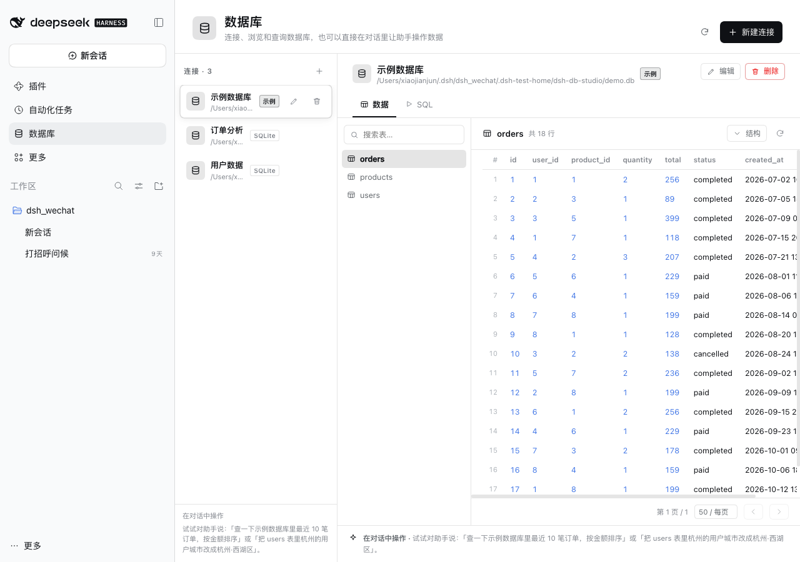
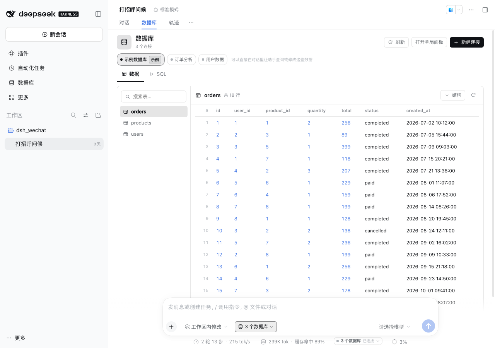

# dsh-db-studio

[](https://github.com/etShaw-zh/dsh-db-studio/actions/workflows/test.yml)
[](LICENSE)

给 [DeepSeek Harness](https://github.com/deepseek-ai/deepseek-harness)（DSH）用的数据库工作台插件：

- **左侧栏入口**：侧边栏「插件 / 自动化任务」旁边多一个「数据库」图标，点开是完整的数据库面板；
- **连接数据库**：SQLite（内置，无需驱动）、PostgreSQL、MySQL；
- **浏览数据**：连接列表、表 / 视图列表、字段结构、分页数据表格；
- **SQL 控制台**：只读查询自动走 `db_query`，写语句走 `db_execute`，结果直接以表格返回；
- **在对话框里操作数据**：注册了 4 个模型可调用的工具，安装后可以直接对助手说：

  > 查一下示例数据库里最近 10 笔订单，按金额排序
  >
  > users 表里杭州的用户城市改成「杭州·西湖区」
  >
  > 给我建一张 notes 表，字段是 id、title、body、created_at

- **开箱即用**：第一次启动会自动创建一个带 `users` / `products` / `orders` 数据的示例 SQLite 数据库，不需要先配置。



## 安装

### 从 GitHub 安装（推荐）

```bash
# macOS 桌面端自带的 CLI，避免用到旧版全局 dsh
DSH_CLI="/Applications/DeepSeek Harness.app/Contents/Resources/runtime/cli/bin/dsh"

"$DSH_CLI" plugin --profile desktop add github:etShaw-zh/dsh-db-studio
```

Windows / Linux 的 CLI 路径以本机安装为准；核心命令都是 `dsh plugin --profile desktop add ...`。

### 从本地源码安装

```bash
git clone https://github.com/etShaw-zh/dsh-db-studio.git
cd dsh-db-studio
npm install                       # 本地开发/测试需要
"$DSH_CLI" plugin --profile desktop add "$PWD"
```

然后**重启 DeepSeek Harness**。插件由 host 半（Cordis 插件）和 browser 半（`lib/client.js`）组成，页面刷新不会加载新的 host 插件，必须重启应用。

卸载：

```bash
"$DSH_CLI" plugin --profile desktop remove dsh-db-studio
```

## 使用

### 1. 侧边栏

重启后，左侧栏的「插件」下方会出现「数据库」。展开的侧边栏显示图标 + 文字，收起成 56px 图标栏时只显示图标；点击即打开全局面板。

面板分三块：

| 区域 | 作用 |
| --- | --- |
| 连接列表 | 新建 / 编辑 / 删除连接，查看当前连接和类型；窄窗口下收进顶部的下拉框 |
| 表列表 | 当前库的表和视图，可按名称搜索；窄窗口下收进数据区顶部下拉框 |
| 数据 / SQL | 「数据」分页浏览行数据、展开字段结构；「SQL」直接执行语句并看结果 |

### 2. 新建连接

点「新建连接」：

- **SQLite**：填文件路径，支持 `~/...`；文件不存在时会新建。父目录必须存在。
- **PostgreSQL**：主机、端口（默认 5432）、数据库、用户名、密码，可选 SSL。
- **MySQL**：主机、端口（默认 3306）、数据库、用户名、密码，可选 SSL。

「测试连接」会在保存前验证；保存后立即出现在连接列表。勾选「只读连接」会禁止该连接上的所有写操作。

### 3. 在对话里操作数据

安装后，模型会看到 4 个工具：

| 工具 | 作用 |
| --- | --- |
| `db_list_connections` | 列出已配置的连接（不含密码） |
| `db_describe_schema` | 列出表 / 视图；给 `table` 时返回字段、类型、主键、默认值、行数 |
| `db_query` | 执行**只读** SQL（SELECT / WITH / EXPLAIN / SHOW / PRAGMA），结果上限由 `maxRows` 控制；只接受当前会话已选中的连接 |
| `db_execute` | 执行**单条写**语句（INSERT / UPDATE / DELETE / DDL），必须显式 `confirm: true` |

几条设计约束：

- `db_query` 在 SQL 层拒绝写关键字，并且按单条语句校验；写操作只有 `db_execute` 能做。
- `db_execute` 要求模型显式确认；连接是只读、或配置 `allowWrite: false` 时直接拒绝。
- 工具只返回脱敏后的连接信息，密码不会进入浏览器，也不会进入模型上下文。
- 返回结果同时包含结构化 `rows` 和一段 Markdown 表格摘要，对话里能直接读。

示例对话：

```
你：看看这个库里有哪些表
助手：（调用 db_list_connections / db_describe_schema）目前有 users、products、orders 三张表……

你：按城市统计订单总额，从高到低
助手：（调用 db_query）北京 921、杭州 573、深圳 465……

你：把 products 里 stock 小于 20 的补到 20
助手：（调用 db_execute，confirm: true）更新了 2 行……
```


### 4. 对话里的数据库（会话级）

除了全局「数据库」面板，插件还把数据库接进了每个对话：

- **对话页新增「数据库」tab**：位于「对话」和「轨迹」之间，展示当前会话选中的数据库，可以浏览表、看结构、分页查数据、执行 SQL。
- **输入框旁新增数据库多选下拉**：就在工作区 / 访问模式下拉框旁边；勾选多个连接，**全选 / 清空 / 完成**。选择是会话级的，切换会话各自保留。
- **输入框下方新增连接状态条**：单连接显示 `● 示例数据库 · SQLite · 3 张表`；多连接压缩成一个 `3 个数据库 · 已连接` 的胶囊，点击展开每个连接的状态/表数/延迟，不会撑宽或换行；连接失败变红，未选择时隐藏。
- **默认选择**：新会话首次打开时，默认全选「最近在该工作区使用过的连接」；如果这个工作区还没用过任何连接，则回退到全部已配置连接。
- **严格作用域**：对话里的 AI 工具**只能操作当前会话已选中的数据库**。未选择任何数据库时，工具会提示「请先在输入框旁选择数据库」；显式指定未选中的连接也会被拒绝。全局面板不受此限制。
- tab 常驻；没有连接时，空状态里提供「新建连接 / 使用示例数据库 / 打开全局面板」入口。



## 配置

插件配置走 profile 的 patch 层。默认值：

```yaml
- insert:
    - id: db-studio
      name: dsh-db-studio
      config:
        demo: true          # 无连接时自动创建示例 SQLite 数据库
        allowWrite: true    # 是否允许 db_execute 和面板里的写 SQL
        agentTools: true    # 是否注册 4 个模型工具（false 时面板仍可用）
        maxRows: 200        # db_query / 数据分页的最大返回行数
        # dshHome: /path/to/.dsh   # 多实例部署时指定数据目录，优先于 $DSH_HOME
```

如果你想在设置面板之外覆盖，编辑 `~/.dsh/profiles/desktop/cordis.patch.yml`，把对应的配置写进 `db-studio` 行即可。实际生效以 `--dump-config` 为准。

## 数据与安全

- 连接配置保存在 `$DSH_HOME/dsh-db-studio/connections.json`，目录 `0700`、文件 `0600`。
- **密码以明文保存在这个本地文件里**（数据库客户端必须能自动重连）。如果需要更高安全性：
  - 给插件创建只读数据库账号，并勾选「只读连接」；
  - 或只连接 SQLite 文件；
  - 或把 `allowWrite` 设为 `false`。
- 浏览器只拿到 `hasPassword: true/false`，拿不到密码；HTTP 路由只监听本机 Web 服务。
- 示例数据库在 `$DSH_HOME/dsh-db-studio/demo.db`，随时可以在面板里删除；删掉后再点「使用示例数据库」会重新生成。
- 插件不会上报任何数据；除了用户主动配置的数据库连接，不发起外部网络请求。

## 依赖与兼容性

- DSH `>= 0.2.1-rc.3`（在 0.2.1-rc.3 桌面端验证）。
- SQLite 使用 Node 内置的 `node:sqlite`，不需要额外依赖。
- PostgreSQL / MySQL 使用 `pg` / `mysql2`，已列入插件 `dependencies`；安装插件时会自动装进 profile。部署环境没有网络时，可以只使用 SQLite。
- 运行环境需要 Node `>= 22.13`（`node:sqlite` 无需 flag 的版本）。

## 开发

```bash
cd dsh-db-studio
npm install          # 安装 pg / mysql2，便于本地测试
node --test test/*.test.js
```

测试覆盖：

- 连接配置校验、密码脱敏、文件权限；
- 示例库创建、表结构、分页、只读守卫、写操作；
- HTTP action 分发与路由注册；
- 客户端 bundle 的侧边栏入口 / `main` 面板注册。

本地调试建议用独立的 `DSH_HOME` 起一个测试 profile，不碰正在使用的桌面 profile：

```bash
export DSH_HOME="$PWD/.dsh-test-home"
"$DSH_CLI" --profile testdb --from-default-profile web --dump-config
"$DSH_CLI" plugin --profile testdb add "$PWD/dsh-db-studio"
"$DSH_CLI" --profile testdb --no-open --port 64820
```

## 已知限制

- 面板是数据浏览 + SQL 控制台，没有做成 Excel 式的单元格编辑；改数据请用 SQL 或对话工具。
- SQLite 同一时刻只允许一个进程写入；插件按连接串行化写操作，但没有实现跨进程锁。
- 没有 SSH 隧道 / 云数据库 IAM 登录；需要这些时请先在本机建好隧道，再连接 `127.0.0.1`。
- MySQL / PostgreSQL 的标识符引用和分页语法分别按各自方言处理；复杂 SQL 仍以数据库返回的错误为准。

## 实现结构

| 文件 | 作用 |
| --- | --- |
| `lib/index.js` | Cordis 入口：`POST /dsh-db-studio/api` 路由 + 4 个工具注册 + 配置校验 |
| `lib/session-store.js` | 每个会话的数据库选择与「最近使用」记录，供 tab / 下拉 / 状态条 / 工具共享 |
| `lib/service.js` | 无 Cordis 依赖的服务层：连接生命周期、示例库、查询 / 写策略、分页 |
| `lib/drivers.js` | SQLite / PostgreSQL / MySQL 适配器，SQL 只读守卫与单语句校验 |
| `lib/store.js` | `connections.json` 的读写、校验、密码脱敏 |
| `lib/home.js` | `$DSH_HOME` 解析与 `~` 展开 |
| `lib/client.js` | 浏览器半：全局侧栏面板 + 对话 `conversation.view` tab、`conversation.input.left` 多选下拉、`conversation.composer.dock` 状态条 |

## 项目地址

- GitHub: <https://github.com/etShaw-zh/dsh-db-studio>
- Issues: <https://github.com/etShaw-zh/dsh-db-studio/issues>
